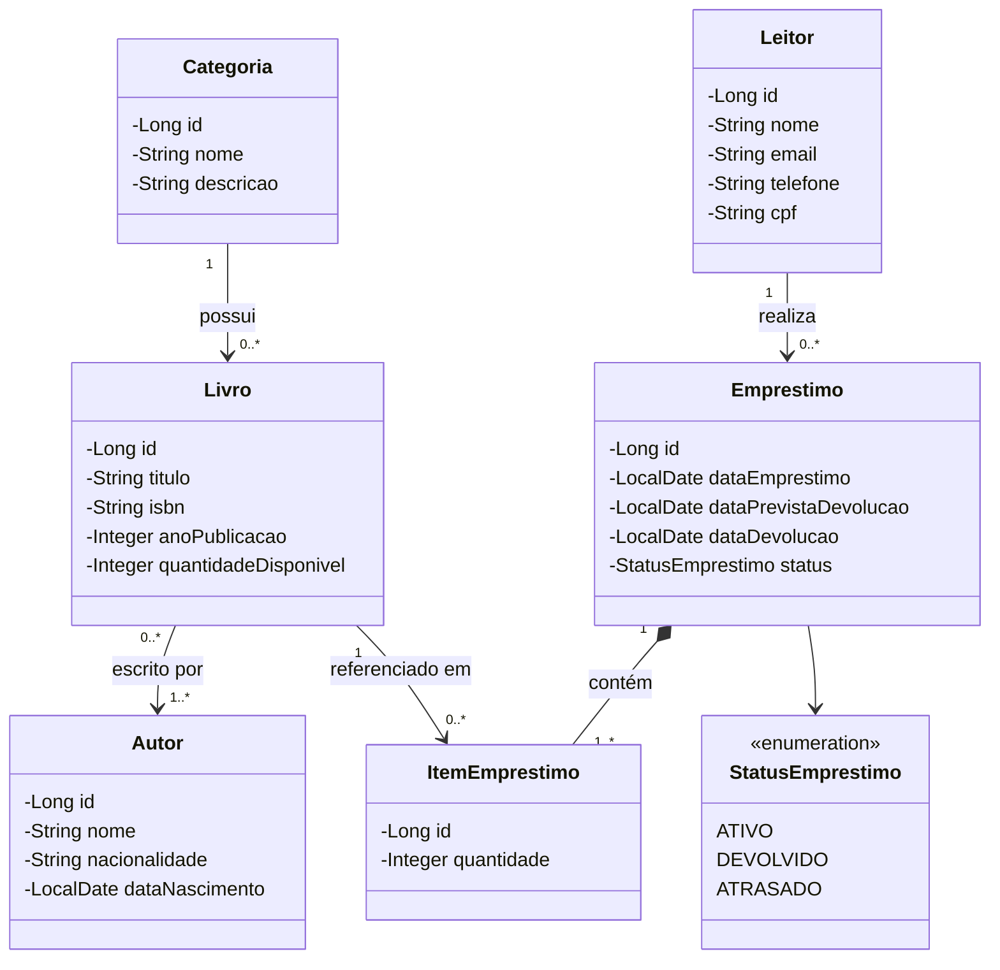
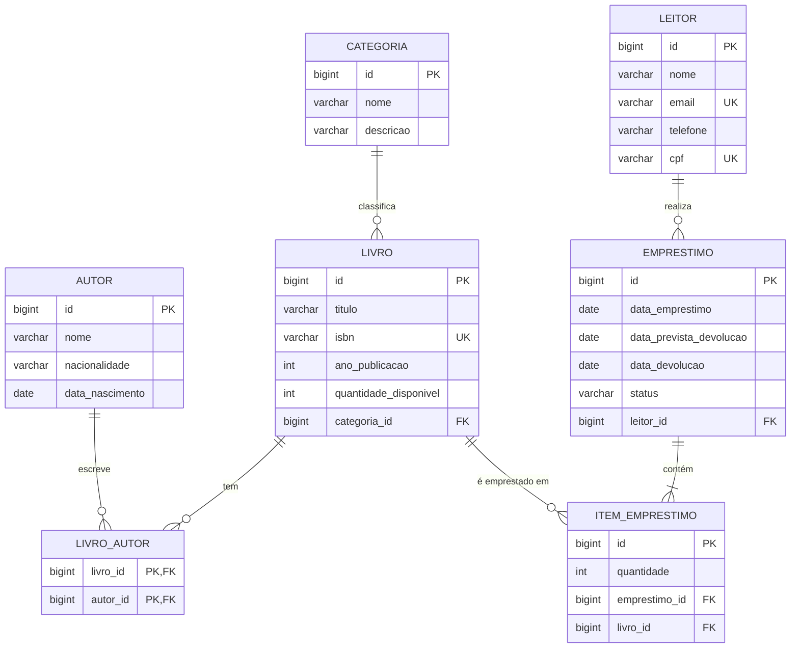

# 📚 Sistema de Biblioteca Comunitária

Sistema web desenvolvido com Spring Boot, Spring MVC, Thymeleaf e Spring Data JPA.

## Tema
Gerenciamento de acervo, leitores e empréstimos de uma biblioteca.

## Tecnologias
- Java 17+, Spring Boot, Spring MVC, Spring Data JPA
- Thymeleaf, HTML/CSS/JS
- Banco de dados: MySQL / PostgreSQL

## Arquitetura MVC
- **Model:** Entity, Repository, Service
- **Controller:** Controllers (acessam apenas Services)
- **View:** Templates Thymeleaf

## Protótipos de tela

### Home
```
+--------------------------------------------------+
|  📚 Biblioteca Comunitária                       |
|  [Livros] [Autores] [Categorias] [Leitores]      |
|  [Empréstimos]                                   |
+--------------------------------------------------+
|   Bem-vindo!                                     |
|   +---------+ +---------+ +---------+            |
|   | 120     | | 45      | | 8       |            |
|   | Livros  | | Leitores| | Ativos  |            |
|   +---------+ +---------+ +---------+            |
+--------------------------------------------------+
```

### Listagem de livros
```
+--------------------------------------------------+
|  Livros                          [+ Novo Livro]  |
|  Buscar: [____________] [🔍]                     |
+--------------------------------------------------+
| ID | Título        | Categoria  | Autor     | Ações |
|----|---------------|------------|-----------|-------|
| 1  | Dom Casmurro  | Romance    | Machado   | ✏️ 🗑️ |
| 2  | Clean Code    | Tecnologia | R. Martin | ✏️ 🗑️ |
+--------------------------------------------------+
```

### Formulário de livro
```
+--------------------------------------------------+
|  Cadastrar Livro                                 |
|  Título:     [______________________]            |
|  ISBN:       [______________________]            |
|  Ano:        [______]  Qtd: [____]               |
|  Categoria:  [ Selecione ▼ ]                     |
|  Autores:    [☐ Machado de Assis] [☐ R. Martin]  |
|                                                  |
|            [Salvar]  [Cancelar]                  |
+--------------------------------------------------+
```

### Novo empréstimo
```
+--------------------------------------------------+
|  Novo Empréstimo                                 |
|  Leitor:      [ Selecione ▼ ]                    |
|  Devolução:   [__/__/____]                       |
|  Livros:      [ Selecione ▼ ] Qtd [_] [Adicionar]|
|  +--------------------------------------------+  |
|  | Dom Casmurro        | 1 | 🗑️               |  |
|  +--------------------------------------------+  |
|            [Registrar]  [Cancelar]               |
+--------------------------------------------------+
```

> As demais entidades (Autores, Categorias e Leitores) seguem o mesmo padrão: listagem, formulário de cadastro/edição e exclusão com confirmação.

## Diagrama de classes



## Diagrama MER


## Como executar
1. Java 17+ e Maven (ou uma IDE com suporte a Maven)
2. Execute a classe `BibliotecaApplication`
3. Acesse http://localhost:8080
